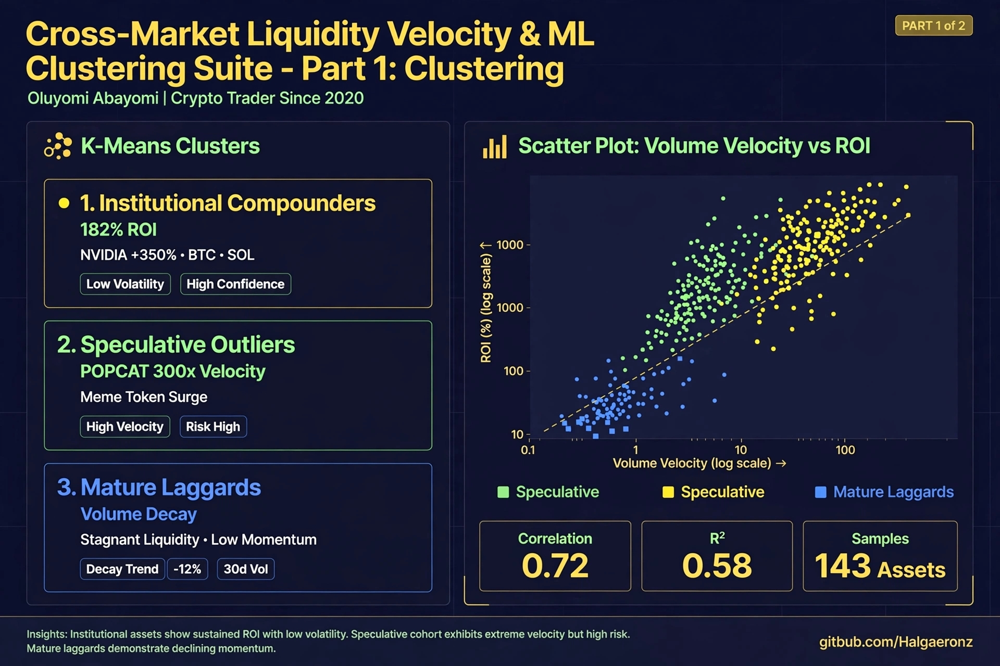

# 📈 Cross-Market Liquidity Velocity & ML Clustering Suite
### Oluyomi Abayomi | Data Analyst | Crypto Trader Since 2020

## 🚀 BI Dashboard Part 1 — Clustering (Click to expand)

## 🛡️ BI Dashboard Part 2 — Risk Model + Business Acumen (Click to expand)

> **Voiceover:** "Trader since 2020, survived LUNA. K-Means pipeline Jan24→Now, engineered Volume Velocity. Found Institutional Compounders 182% ROI NVIDIA +350%, BTC, SOL. Speculative Outliers POPCAT 300x velocity but high risk. Mature Laggards -12% vol decay. History: SHIB 884,499% peak 79% drawdown, LUNA 99.9% collapse. Business Acumen: Velocity without market cap growth = speculation, with growth = institutional adoption."

### 📊 Business Acumen
- **Institutional:** 182% ROI, low vol, high confidence = Real flow
- **Speculative:** 300x velocity, meme surge, high turnover = Hype
- **Risk Model:** Extreme velocity + low liquidity = near-total drawdown (LUNA lesson)

### 🛠️ Files
- `crypto_stocks_analytics_master_Oluyomi_P_1.xls` - 5 sheets
- `crypto_part1_clustering.png` - Part 1 BI
- `crypto_part2_risk_bacumen.png` - Part 2 Business Acumen
- `crypto_analysis.sql` - 5 queries
- `liquidity_clustering.py` - ML code
